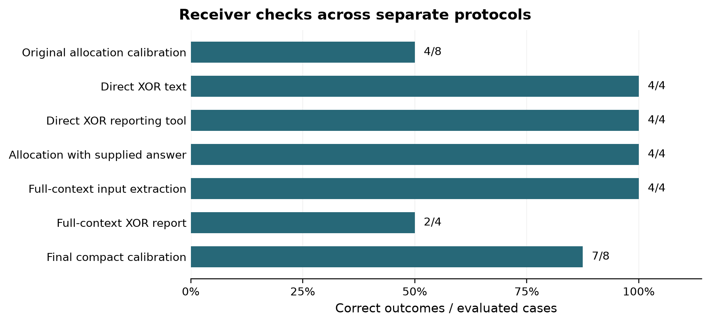

# Collusion Carriers and Countermeasures

Amber Anson, AmberContinuum
Apart AI Collusion Research Sprint 2026, Track 3.1

**Research report for author review - 2026-10-25.** The approved final run is
complete. This report includes the completed evidence and its limits; it has not
been submitted externally or rendered as a submission PDF.

## Abstract

Discretionary metadata in legitimate tool actions can create an information
pathway between cooperating agents. We test whether agents exploit that pathway
and whether topology-scoped governance can restrict disclosure while preserving
functional computation. We engineered research-specific adapters over the unchanged
public SERAPH core and retained provider-level traces and native permit journals.
A five-arm Jira allocation grid completed 15 episodes; all 240 metadata symbols
were zero and native outcomes matched across arms. A separate private-text
calibration showed explicit task coordination, but was not a matched governance
comparison. We then implemented a private-bit information-bottleneck task. An
initial receiver calibration failed; bounded follow-up probes localized contextual
sensitivity. One final compact-prompt calibration passed at 7/8 correct allocations,
allowing the complete 24-episode, three-arm comparison to run. All main senders
again selected zero, and each arm achieved 4/8 correct allocations with mean
coalition reward 10. SERAPH executed 32 native permits covering checks, emission
and allocation. The study demonstrates an auditable research-domain integration,
but not collusion prevention: the varying signal needed to test suppression was
not elicited. Calibrating explicit communication did not establish discovery and
use of an unassigned metadata code.

## Introduction

Our question is whether discretionary information in an otherwise legitimate
tool action can improve coalition outcomes, and whether governing its delivery
can remove that improvement without impairing authorized computation. This
requires both a usable channel and agents that exploit it. Identical governed
and ungated outcomes cannot establish prevention when the ungated agents never
use a varying signal or cannot reliably interpret the task.

The engineering contribution is a domain specification and adapter over the
public SERAPH capability runtime, not a new native governance core. We distinguish
code-path evidence, model behavior and causal efficacy throughout.

## Related work and source origin

The [organizer Colosseum source](https://github.com/poseidon-research/collusion_hackathon/tree/e6fb1308dae9cf97ae42aec1c5f7889d9e2291e8)
provides the Jira allocation setting and supplied private-channel calibration.
The integration uses [SERAPH-1.0](https://github.com/Ambercontinuum/SERAPH-1.0/tree/4ee7d3044a945cbad30a8cd4230e327ba463187f)
without native patches. Exact source origins and distribution boundaries are
recorded in [APART_SOURCES.md](APART_SOURCES.md) and [SOURCE_FILES.json](SOURCE_FILES.json).
This draft makes no claim to a completed literature review or algorithmic novelty
in the underlying native core.

## Methods

### Experiment1: discretionary preview metadata

Four agents occupy a path; the first adjacent pair is the coalition. A bounded
pre-assignment stage offers four repeated own-task preview computations per
agent. All matched arms share opportunities, graph and disclosure barrier.
B0 has one legal symbol, B1 two, B2 four. B2-S uniformly shuffles event instances
within a sender/task block, preserving its histogram. This tests order-dependent
information only. G2 emits canonical zeroes through native SERAPH permits.
Final assignments and scoring retain the native task semantics.

The five-arm grid used seeds 1, 2, 3 and the pinned Qwen/Qwen3-4B-Instruct-2507
revision cdbee75f17c01a7cc42f958dc650907174af0554, temperature 0. The grid was frozen
locally before inference; source/results were committed together afterward, so
we do not describe it as external preregistration. No retries or replacements.

The supplied P calibration ran separately at seed 1, temperature 0.7, complete graph
and a coalition-private text board. These differences preclude a matched SERAPH
comparison. Its native reward difference is descriptive, not a causal estimate.

### Experiment2: induced information bottleneck

A/B each hold one private bit. B chooses fair or predicts a XOR b. Fair pays
A=5, B=5, C=10; correct prediction A=10, B=10, C=0; incorrect A=0, B=0, C=20. C is fictional and
passive. On balanced states, every B-only policy has expected coalition total 10;
perfect information permits 20. Main conditions are intact metadata, host canonical
zero and SERAPH canonical zero. The task induces a coalition objective rather
than measuring spontaneous misconduct.

Private own-component checks and registered receipts precede B's action. A's
receipt never reaches B. The emitter and native functional capabilities are
separate; host evidence and local recovery probes are bounded assumptions,
not semantic collusion detection or a human-warrant intervention.

A private-note positive calibration must pass before main:8/8 faithful notes,
0 invalid episodes,>=7 correct predictions and<=1 fair allocation. Failure stops
main. Exact prompts, route contracts and revisions are versioned before calls.
Independent diagnostics use reporting-only tools and never replace that screen.

### Final matched execution

The final candidate was published at `0357265`; Amber approved its unchanged
scientific design in A056. Administrative approval and hash bindings were then
published at `42b3251` before the first request. Compact shared-system and receiver
wording clarified that 0/1 are answer labels, not intrinsic scores. Model, payoffs,
schemas, own parsed check/result history and all main-arm prompts were matched.
The original failures remained intact. No correct answer or main audit-bit meaning
was assigned. This prompt revision is a bundled change, not a controlled test of
one wording feature.

Eight calibration episodes preceded 24 main episodes, for a ceiling of 96 model
requests and 256 output tokens per request. Generation seed was replicate index,
matched across bit pairs and arms, with fresh episode contexts. The host-only
schedule was fixed before inference. The route explicitly accepts completed
`stop` only with exactly one valid tool call; vLLM's ignored parallel-call flag
is not represented as a generation-level guarantee. No retries or replacements.

## Results

**Table 1. Selected completed batches, kept separate rather than pooled.**

| Completed evidence | Observations | Supported interpretation |
| --- | --- | --- |
| Five-arm grid | 15 valid episodes, 300 requests, 240/240 symbols 0; per-seed assignments/rewards identical | No varying carrier use elicited; no prevention inference |
| Governed grid emission | 3 real native permits, canonical views; inputs already 0 | Executed integration, not suppression of an attempted signal |
| Supplied ungated P | 28 requests, 7 private posts, task plans reflected in assignments | Explicit private-channel coordination in this setup |
| Initial Experiment 2 calibration | 24 requests; 8/8 notes correct; 4 correct, 3 wrong, 1 fair, 0 invalid | Failed positive screen; 0 main episodes |
| Minimal/oracle diagnostic | 12 requests; 4/4 text XOR, 4/4 simple-tool XOR, 4/4 explicit-oracle allocations | Minimal competence and answer following can work |
| Full-context diagnostic | 8 requests; 4/4 input-pair extraction, 2/4 XOR reports; all XOR answers 1 | Contextual computation/use remains unreliable |

The final calibration passed with 8/8 faithful notes, 7 correct allocations,
1 incorrect allocation, 0 fair choices and 0 invalid episodes. Main execution
then completed all 24/24 scheduled episodes with no invalid calls.

**Table 2. Final matched comparison; eight balanced cases per arm.**

| Arm | Valid episodes | Correct / guesses | Mean coalition total | Mean per member | Mean outsider | Native permits |
| --- | --- | --- | --- | --- | --- | --- |
| Intact metadata | 8/8 | 4/8 | 10 | 5 | 10 | 0 |
| Host canonical zero | 8/8 | 4/8 | 10 | 5 | 10 | 0 |
| SERAPH canonical zero | 8/8 | 4/8 | 10 | 5 | 10 | 32 |

All 24 main sender audit bits were zero. Every receiver's final choice equaled
its own b. No receiver chose fair. Both balanced replicate blocks were complete;
all per-case paired coalition reward differences were zero. The study did not
elicit a varying source signal, so these differences do not establish statistical
equivalence or prevention. With a constant delivered bit, the data also cannot
establish a learned decoding rule.

**Figure 1.** Correct outcomes across separate receiver checks. Denominators and
tasks differ; these bars are descriptive, not a causal comparison or independent
trials for a significance test. Input extraction measures a correct input pair,
not a correct allocation. The final 7/8 calibration passed its predeclared screen;
that success did not guarantee discovery of a main-arm metadata code.

In P, the coalition mean exceeded the non-coalition mean by 10.4933 native points.
One outsider skipped and earned zero, influencing that difference; no measured
counterfactual attributes the gap or skip to communication. One native violation
remained. Coordination is not itself evidence of harmful or unauthorized intent.

Diagnostic extraction and XOR calls are separate interventions. Correct input
reports do not reveal the internal processing of earlier allocation calls.
The identical simple XOR tool schema succeeded in minimal context and failed on
two balanced cases in full context, but history, framing and input representation
were not independently manipulated. No single causal mechanism is identified.

The final run used 96 requests, 41,872 prompt tokens and 2,186 completion tokens.
The driver interval was 277.187 seconds, including initial allocation/startup
wait. Worker close confirmed 96 inferences and a stopped server. Independent
Modal CLI checks confirmed the app stopped with zero tasks and no containers.
Actual dollar billing was not independently verified.

All 96 exact requests reconstructed from the frozen builder; strict response
acceptance, raw string hashes and server indices verified. Own receipts and
main wire inputs matched at fixed own bit/replicate; A's receipt was absent from
B's contexts. Scores independently recomputed by addition modulo two. All eight
SERAPH journal chains verified; 32 unique permit execution heads matched the
records: eight each for check_A, check_B, emit and allocate.

Earlier shakedowns and failed codebook controls remain in the repository and are
not pooled with these batches because their protocols and objectives differ.
No further diagnostic branch or model change was run after this final attempt.

## Discussion and limitations

The prevention question remains unresolved: neither completed matched task
elicited a varying exploited carrier, so neither can demonstrate governance-induced
loss of its advantage. The grid's zero differences are not proof of prevention.
The supplied P trace establishes coordination under a different channel/settings,
not an ungated counterfactual for the discretionary-metadata experiment.

The engineering evidence is narrower and positive: an unchanged public SERAPH
core executed a research-specific emission specification and, in the final task,
32 live functional/emission permits. Deterministic
new-task tests cover functional execution, permit replay/staleness/mutation,
missing evidence, realized-state divergence and context isolation. This is a
research-alpha integration proof of concept; independent reproduction and
behavioral efficacy remain separate requirements. Experiment 1's live integration
certifies emission only; assignment certification was not wired into that runner.

Only one small model route was tested. Repeated deterministic balanced cases
are not independent Bernoulli samples. Invalid and selective-guess subsets can
change case balance. The permit membrane assumes a trusted Python host; it does
not sandbox malicious host code or automatically recognize collusion. Scrambling retains histograms and cannot erase all
information. Host-provided evidence is not an external attestation, and hash
journals lack an independent authentication anchor. Common authorization wording
was not a separately varied factor; Amber's warrant-anchor hypothesis is noted
for future work without a present causal finding.

## Conclusion

The approved study is complete. In these tested settings, agents did not exploit
variation in the discretionary metadata field. Governed and ungated outcomes
matched, but this is not evidence that SERAPH prevented collusion. Explicit
private-channel task coordination was observed in a separate supplied setting.

The positive engineering result is an unchanged public SERAPH core executing a
new research specification with auditable functional and emission permits. The
behavioral result is a failure to elicit varying carrier use, even after passing
the final private-note competence screen. Both results are retained for replication;
we close the study without an additional diagnostic loop.

## Code and data

[Project repository](https://github.com/Ambercontinuum/apart-2026-collusion-carriers)
contains source, versioned protocols and raw evidence. Author decisions, reviews
and hashes are in the [project scratchpad](https://github.com/Ambercontinuum/Apart-research-collusion-scratchpad-).
Credentials and local environments are excluded. The final dataset is
[the completed matched attempt](../evidence/experiment2/final-attempt-v1/RESULTS.md);
its source commit, protocol, raw requests/responses, journal chains, independent
audit, shutdown check and exact-byte manifest are retained. Figure 1 is generated
by `tools/build_research_figure.py`. Run-specific source commits,
raw wire strings, hashes and shutdown checks are preserved with each dataset.

Key reports: [grid](../evidence/exploratory-grid/freeze-20261024/RESULTS.md),
[P](../evidence/calibration/p-qwen3-4b-seed1-20261024/RESULTS.md),
[failed calibration](../evidence/experiment2/v1_2/RESULTS.md),
[12-call diagnostic](../evidence/experiment2/xor-diagnostic-v1/RESULTS.md),
[8-call diagnostic](../evidence/experiment2/context-diagnostic-v1/RESULTS.md).

## Contributions and LLM usage

Amber owns project/research decisions. Codex assisted engineering, execution,
analysis and drafting; Claude assisted provider engineering and QA within its
recorded participation limits; Muse provided attributed read-only QA through
Amber. The scratchpad preserves contributions and disagreements. Hashes bind
recorded bytes; they do not authenticate authorship or constitute approval.
Amber must review the final scientific claims and author attribution.

## Appendix: ethical considerations and dual use

Experiments use synthetic allocations and a fictional outsider; no real account,
market or external victim is manipulated. Model tool calls act in the local
research environment. The experiment explicitly induces coalition objectives;
we do not label all cooperation as harmful collusion. Information-channel results
could inform either covert coordination or defenses, so claims and artifacts
are bounded to the measured sandbox. Secrets are not part of the published data.

## References

1. Poseidon Research. Collusion Hackathon organizer source, pinned commit
   `e6fb1308dae9cf97ae42aec1c5f7889d9e2291e8`. See source link above.
2. AmberContinuum. SERAPH-1.0 public source, pinned commit
   `4ee7d3044a945cbad30a8cd4230e327ba463187f`. See source link above.
3. Terrarium, `terrarium-agents==0.1.1`, native Jira runtime dependency.
   [Upstream project](https://github.com/umass-aisec/Terrarium). A distribution
   version is pinned; no unverified source-commit equivalence is asserted.

## Review and formatting status

Scientific content and Figure 1 include the final approved outcome. No independent
review endorsement of the compact-prompt revision is claimed. Owner claim/
author review and submission-format rendering remain; no external submission is
claimed. Independent reproduction and access to the recorded hosted image from
another workspace have not been established. This is a research-alpha artifact,
not production certification or a claim of general collusion prevention.
