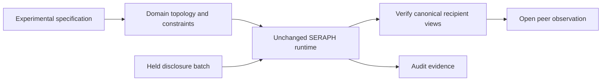

# SERAPH as an experimental research instrument

## Completed as-built exploratory grid - 2026-10-24

Latest empirical checkpoint supersedes earlier no-live-episode statements below:
15/15 valid episodes acrossfivearms/seeds1-3,300requests, all240symbols zero.
Native outcomes identical byseed acrossarms. Three live canonical-emission
permits completed; no varying signal was presented for suppression. P notrun,
assignment certification unwired, Gate0 incomplete. No prevention/superiority
claim. See project README and evidence/exploratory-grid/freeze-20261024/RESULTS.md
for fixed conditions, all raw traces, failed-control limitations and analysis.
Earlier tables remain historical engineering checkpoints.

Our engineering objective is to turn explicit research specifications into
executable governance others can inspect and reproduce. This complements the
frozen behavioral question; it does not replace an unsuccessful or null result.

## Native source delta

**Zero patches to the pinned public SERAPH core.** We load
[SERAPH-1.0 at 4ee7d30](https://github.com/Ambercontinuum/SERAPH-1.0/tree/4ee7d3044a945cbad30a8cd4230e327ba463187f).
The loader checks the commit, clean checkout and imported module locations.
The private sibling SERAPH is background only. No native SERAPH source is copied
into this repository.

The [source audit](../evidence/gate0/seraph-integration-audit.json) records the
clean tree, empty core diff, native Git blob identities, separate working-file
SHA-256 values and integration source identities. An unchanged core matters:
the new domain is expressed through existing contracts rather than hidden patches.

## Specification to implementation

| Experimental requirement | Unchanged SERAPH mechanism | New sprint engineering |
| --- | --- | --- |
| Preserve legitimate computation | Manifold coordinates and preservation rules | Native Jira state digest; preview returns own cost/feasibility without task mutation. |
| Account for information consequences | Directed consequence edges and affected-set closure | Native-task → peer-batch → recipient-view topology. The whole batch affects all recipients; path-neighbor audiences determine each view's content. |
| Resolve evidence before emission | Scoped constraint frame and transition governance | Observe native digest preservation and require host canonical-emission evidence; missing evidence holds disclosure. |
| Bind approval to execution | Certified tool guard, registered capability and one-use permit | Register canonical publisher; bind exact payload, callable, source state, scopes and recipients; reject replay, mutation and stale state. |
| Verify before observation | Postconditions and divergence callback | Stage held views, verify resulting view digests, then open peer access; failure resets buffers and keeps access closed. |
| Preserve inspectable evidence | Hash-chain journal | Persist governance events beside exact provider contexts, responses, tool results and source/configuration/output hashes. |

Code: [seraph_bridge.py](../colosseum/experiments/collusion/apart_2026/seraph_bridge.py),
[preview.py](../colosseum/experiments/collusion/apart_2026/preview.py),
[runner.py](../colosseum/experiments/collusion/apart_2026/runner.py).

`information_emission_authorized` is a host assertion about the declared
canonical policy, supported by exact payload checks and compiled view
postconditions. It is not a semantic collusion detector. Recovery measurement
is a local held-view-buffer reset probe, not validated human–AI coupling or
deployment telemetry. Other kernel defaults remain declared adapter assumptions.
Host topology and observations must be honest and complete; unmediated code is
outside this boundary. No independent HMAC witness is configured.

## New application and experimental engineering

New sprint work separates functional computation from disclosure, holds information
behind a matched barrier and instantiates recipient-specific constraints before
observation. The experimental instrument adds symbol menus, a histogram-preserving
shuffle, canonical delivery, isolated agent histories and exact context capture.
This is novelty relative to the starting codebase, not a literature-wide priority
claim. Native governance mechanisms and earlier validation are preexisting SERAPH
work. Jira semantics/scoring come from Terrarium. The repeated previews are an
artificial scaffold and duplicate information already in the private prompt.

## Evidence and limits

| Evidence layer | Current evidence | Supported conclusion |
| --- | --- | --- |
| Prior native instrument | Upstream governance corpus: 17/17 | Baseline validation, not sprint G2 evidence. |
| Sprint integration | 24 deterministic tests; scripted G2 smoke; permit attacks and captured contexts | Engineering proof of concept for canonical information emission through unchanged public contracts. |
| Behavioral research | No model-driven episodes; all five full Gate 0 obligations UNKNOWN | No finding about coalition advantage, order-dependent transfer or model task preservation yet. |
| Research usability | Source pins, dependency lock and reproduction instructions | Reproducible design being prepared; independent fresh-environment reproduction remains unverified. |

Native final assignment is not yet bound to the new permit: current certification
covers emission. Live provider integration, complete channel inventory, matched
configuration and analysis freeze remain open. The adapter uses private preview
fields and a fixed experimental profile; it is not a general integration SDK.
Existing formal work is not formal verification of this experiment.

## Completing the research-alpha demonstration

1. Complete the [requirements map](REQUIREMENTS_STATUS.md) and
   [Gate 0 report](../evidence/gate0/GATE0_REPORT.md), including functional binding
   and unintended-channel checks using actual provider contexts.
2. Independently reproduce positive and adverse cases from a clean environment
   using [RUNNER.md](RUNNER.md), without undocumented patches or dependencies.
3. Freeze analysis and run the separately approved model experiment with complete
   invalid-episode accounting and source/configuration/output identities.
4. Report enforcement, authorized task performance and behavioral effects as
   separate results. Keep instrument detail in linked code/docs within paper scope.

A null carrier effect can coexist with a useful instrument demonstration; it
cannot support a positive behavioral claim. A behavioral effect alone also does
not establish reliable governance or reusable engineering.
